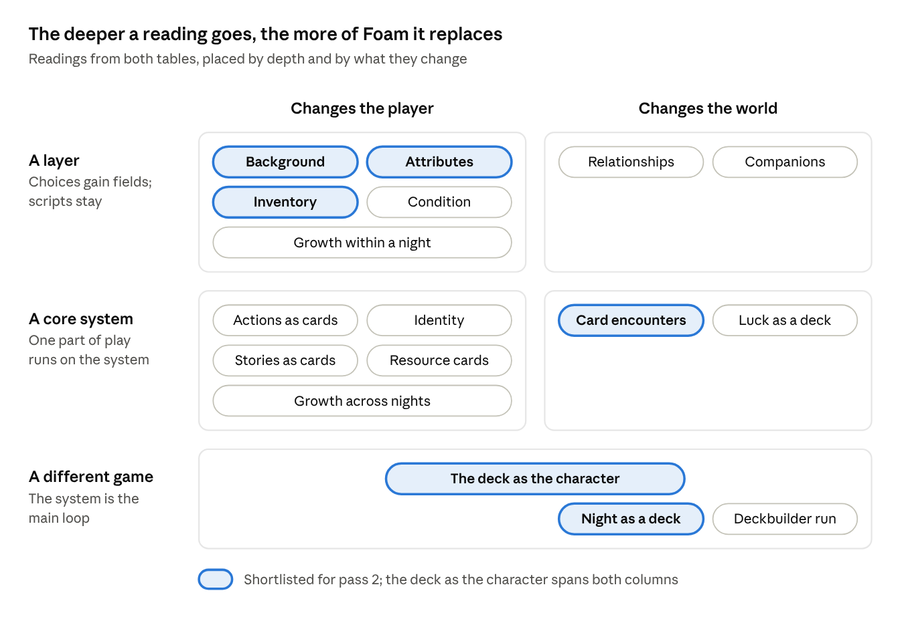

# Foam: RPG and deck-building exploration

Started: 2026-10-28. Status: pass 1 is written; pass 2 waits for the author's answers. The living
version is the [Claude doc](https://claude.ai/artifact/FET75TaMJnd3d81fJJLvgj); this file is its
copy.

## Starting point

Foam's player has no character and no tools of their own: every action is a choice written for one
button of one place. That is the gap RPG and deck-building elements would fill, and this document
first maps what filling it could mean (pass 1), then designs it (pass 2).

What Foam is today, from `apps/foam/docs/direction.md` and `core/night.ts`:

- **The loop.** One night in Brno, 16:00 to 08:00. The player moves between real places on foot, by
  tram or by taxi, and acts through choices that carry a price, minutes, drinks, odds and a level of
  drunkenness.
- **The state.** Time, money and drunkenness; four quest flags (`hasBottle`, `bottleGiven`,
  `hasKeys`, `hasTicket`); the events met tonight; the log.
- **The variation.** A seed drives `night.random` and `night.pick`, and scenes come in versions. Two
  players with one seed play one night.
- **Across nights.** The story collection, the record of past nights and the texts read. A long arc
  across nights is shelved.
- **Next.** Phase 8 adds the phone and the author, Jakub, as a person you can meet.

What the player does not have: attributes, an inventory beyond the quest flags, growth during or
across nights, and any verb that works in more than one place.

This is treated as open exploration. Where a reading collides with a written principle, the
collision is named, not used as a veto.

## Pass 1: what "RPG elements" could mean

"RPG elements" splits into nine readings, and most of them already have a seed in Foam: the dice,
the quest flags and the story collection are each half of an RPG system.

| Reading                     | What it means                                                                               | Seed in Foam today                                        | What it would add                                                  | Reference                                      |
| --------------------------- | ------------------------------------------------------------------------------------------- | --------------------------------------------------------- | ------------------------------------------------------------------ | ---------------------------------------------- |
| Attributes and skill checks | The player has numbers (nerve, charm, stamina, local knowledge) that set the odds of a roll | Dice with shown odds, fixed per choice                    | The same choice plays differently for different players            | Disco Elysium, Fallen London                   |
| Background                  | Who gets off the train is chosen or drawn: a student, a returning local, a tourist          | One avatar; start money from a range                      | Variety from the player's side, not only the world's               | Citizen Sleeper, Sunless Sea                   |
| Growth within a night       | The player gains capability as the night goes on                                            | None: time and money only drain, drunkenness only rises   | A curve inside the run                                             | Most roguelikes                                |
| Growth across nights        | Unlocks that carry into the next night                                                      | The story collection, texts read; the long arc is shelved | A reason to replay beyond collecting stories                       | Hades, Rogue Legacy                            |
| Inventory                   | Things in the pockets that open or change choices: a lighter, an umbrella, a tram pass      | The four quest flags are items in disguise                | A general way for one scene to affect another                      | Most RPGs                                      |
| Condition                   | More body state than drunkenness: tiredness, hunger, mood, phone battery                    | Drunkenness, "written, not ruled"                         | More pressure from the body, more texts that branch                | Darkest Dungeon's stress, Sunless Sea's terror |
| Relationships               | People remember the player within the night, or across nights                               | Events met once; people only there at certain hours       | A social layer: a bartender who likes you, a stranger who owes you | Persona, Fallen London                         |
| Companions                  | Someone joins the player for part of the night and colours the scenes                       | The friend is a quest target, never company               | A second voice in every scene                                      | Mass Effect, Kentucky Route Zero               |
| Identity                    | Who the player is tonight grows out of their choices: traits, thoughts, a temper            | None                                                      | Self-expression; a night that says something about the player      | Disco Elysium's thought cabinet                |

Three groups fall out of the table:

- **Who you are:** attributes, background, identity.
- **What you have:** inventory, condition, companions.
- **How you change:** growth within a night, growth across nights, relationships.

## Pass 1: what "deck-building elements" could mean

The first question is what a card stands for: the player's moves, the world's events, a resource, or
the player themselves. Each answer gives a different game.

| Reading                   | A card is                                                                                     | Seed in Foam today                              | What it would add                                                     | Reference                                                  |
| ------------------------- | --------------------------------------------------------------------------------------------- | ----------------------------------------------- | --------------------------------------------------------------------- | ---------------------------------------------------------- |
| Actions as cards          | A move the player owns and can play in many places: "Buy a round", "Lie", "Ask a local"       | Every action is a choice written for one button | Verbs the player carries; the same scene answers different hands      | Slay the Spire, Griftlands                                 |
| Encounters as card play   | A move in one conversation or confrontation, played as a short contest                        | Dialogue scripts with choices                   | A small game inside social scenes: talking someone into something     | Griftlands' negotiation, Signs of the Sojourner            |
| The night as a deck       | An event: what happens when the player arrives somewhere or the hour turns                    | Versions picked by the seed; events met once    | A world that reshuffles; cards added and removed as the night goes on | Arkham Horror's encounter decks, Reigns, Cultist Simulator |
| The deck as the character | A trait or habit; the deck is who the player is, and it drifts with whom they spend the night | None                                            | RPG and deck-building in one system: you become the night you had     | Signs of the Sojourner, Griftlands                         |
| Luck as a deck            | A drawn result in place of a roll, from a deck the player can thin or spoil                   | Dice from the seed and the count of rolls       | Luck that can be read and steered                                     | Gloomhaven's modifier deck                                 |
| Resources as cards        | Money, time or energy held as cards in a hand                                                 | Plain numbers in the status line                | A tactile budget                                                      | Dominion                                                   |
| Stories as cards          | A found story becomes a card that later nights can play                                       | The collection of titles, kept across runs      | Meta-progression with a use, not only a list                          | Inscryption, Hades' keepsakes                              |
| The run as a deckbuilder  | Rewards drafted from three after each scene, on a map of branching nodes                      | Free travel on a real map, paid in time         | The "pick one of three" rhythm                                        | Slay the Spire, Monster Train                              |

Two of these readings are not about cards at all but about randomness: "the night as a deck" and
"luck as a deck" replace the seed's draws with a shuffle that remembers what came out. "The deck as
the character" is the one reading where the two families of this exploration become a single system.

## Pass 1: how deep the change goes

The depth of a reading, not its family, decides the cost: a layer adds fields to Foam's choices, a
core system adds a second way of playing, and a different game rewrites the loop.

- **A layer** keeps every script as written; content gains conditions on stats and items. It is the
  cheapest, and closest to how phases 5 to 7 grew the game.
- **A core system** adds a second way of playing beside the story window, used by some scenes. It
  needs its own UI and its own rules in the checker.
- **A different game** makes the cards the loop and the places the board. Most of the existing
  content would be rewritten as cards.

The two families combine in three ways:

1. **RPG for the player, a deck for the world.** The player has stats and items; the night's events
   are shuffled. Two systems that stay apart.
2. **A deck of actions, RPG growth across nights.** Slay the Spire's model: cards inside the night,
   unlocks between nights. Two systems that feed each other.
3. **One system.** The deck is the character, and the people met tonight change it. One system, but
   the deepest change.

## Pass 1: friction with Foam, and what can be reused

Nine of Foam's written decisions push back on these ideas, and the hardest are the seed's promise
that one seed is one night and the rule that variation has no pool.

| Decision in `direction.md`                                    | The friction                                                            | Readings it hits                                                  | A way through                                                                                              |
| ------------------------------------------------------------- | ----------------------------------------------------------------------- | ----------------------------------------------------------------- | ---------------------------------------------------------------------------------------------------------- |
| "The fun is the stories and the uniqueness of each run"       | Systems pull attention to optimising numbers; the night becomes a build | Growth, resources as cards, the run as a deckbuilder              | Every card and stat carries text; a mechanic exists to make a story happen, not to win                     |
| Drunkenness: "What being drunk changes is written, not ruled" | Attributes and condition rule outcomes                                  | Attributes, condition, luck as a deck                             | Numbers set odds and open or close choices; the text still tells what happened                             |
| Variation: "No pool, no table of decisions"                   | A deck is a pool                                                        | The night as a deck, actions as cards, luck as a deck             | Reopen the decision, or keep decks on the player's side only and leave the world as versions               |
| Seed: two players with one seed play one night                | A deck or stats the player built make two nights with one seed differ   | Growth across nights, stories as cards, the deck as the character | The seed fixes the world; the player's deck is theirs. Or a daily night starts everyone from the same deck |
| Content: one script per button                                | A card the player carries must work in places nobody wrote it for       | Actions as cards, inventory, the deck as the character            | A script names the cards and tags it answers; an unanswered card gets a generic line or cannot be played   |
| "Sex and drugs are never romanticised"                        | A stat bonus for being drunk or high rewards it mechanically            | Attributes, condition, growth                                     | No buff without a written cost; intoxication changes texture, not power                                    |
| A phone shows about 32 letters across                         | A hand of cards does not fit a 195-pixel-wide screen                    | Every card reading                                                | Cards as a list in the story window; a hand of 3 to 4                                                      |
| Dice show their odds                                          | A draw hides its odds                                                   | Luck as a deck, encounters as card play                           | Show what is left in the deck, as the odds are shown now                                                   |
| Process: "No system is designed ahead of use"                 | This whole exploration designs ahead                                    | All                                                               | Pass 2 picks one real piece of Brno to carry the first system, as every phase so far did                   |

What already exists and can be reused:

- **Foam's choice type** (price, minutes, drinks, odds, level) can take requirements and effects for
  stats, items and cards without a new kind of content.
- **`night.random` and `night.pick`** can shuffle a deck by the seed and a key, so a deck's order
  stays as deterministic as everything else.
- **`night.events`, `meet` and `hasMet`** already do what an exhausted card does: something met once
  and gone for the night.
- **The quest flags** are an inventory of four; generalising them is a small step.
- **The story collection** is already the thing kept across nights; it can carry cards or unlocks.
- **The phone** (phase 8) is a natural way for the author to hand the player a card or a trait.
- **The checker** (`core/checkContent.ts`) is the costly part: it runs every version of every scene,
  and stats, items and decks multiply the states it must cover.

## Pass 1 outcome: what goes into pass 2

Five readings are worth designing; "the deck as the character" is the strongest, because it is the
only one that is RPG and deck-building at once and it says something about a night out: you come
home a little changed by the people you met.

1. **The deck as the character.** Traits and habits as cards; people you spend time with add their
   cards to your deck and push others out. Deepest change, best fit with "the fun is the stories".
2. **Background and attributes that set the odds.** The smallest step: Foam's dice stay, and their
   odds come from who the player is. Works under any other reading.
3. **Encounters as card play.** A small game for some social scenes only, bolted onto the existing
   scripts. Contained, but a second way of playing to teach.
4. **The night as a deck.** The world's events shuffled by the seed and changed by play. Reopens the
   "no pool" decision; the biggest change to how content is written.
5. **Inventory.** Generalised quest flags. Needed by most of the above, so a likely first step
   whatever is chosen.

Set aside for now, each for one reason:

- **Resources as cards** fights the clock and the money, which already work as plain numbers.
- **Growth within a night** has little room: one night is a few dozen choices.
- **The run as a deckbuilder** fights the real map: Brno is walked, not a branching node graph.
- **Luck as a deck** is interesting but a pure mechanic; it can return inside reading 3.

Questions for the author before pass 2:

- [ ] What is the reason to add these systems: replay value, more decisions per scene, a reason to
      play past the stories, or a night that feels like the player's own?
- [ ] Should two players with one seed still play the same night?
- [ ] Is the "no pool, no table of decisions" rule open to reopening?
- [ ] How many numbers on screen does a text-first game bear? Today there are three: time, money,
      drinks.
- [ ] Should anything carry across nights besides stories? This touches the shelved long arc.

## Pass 2: game design ideas

Not started. Pass 2 begins once pass 1 is reviewed and the questions above are answered. For each
shortlisted reading it will give concrete mechanics, a sketch of one night played with them, how
they fit the seed and versions, and what they cost in content and code.
