# Groovebox part 1 – Look and panel

Status: design, approved by the owner section by section. The sixth and last of six subpart specs of
part 1; see [the part 1 overview](./2026-10-26-groovebox-core-browser-design.md) for the intent, the
goals and the decision register, [Foundation](./2026-11-02-groovebox-foundation-design.md) for how
the core draws and what it may use, [Workflow A](./2026-11-03-groovebox-workflow-a-design.md) and
[Workflow B](./2026-11-05-groovebox-workflow-b-design.md) for what every screen shows and what every
control does, and [the Project model](./2026-11-06-groovebox-project-model-design.md) for the marks
and messages the screens carry.

**Nothing here is final.** The look was designed by drawing every screen pixel by pixel with the
operations the core will have and changing it until the owner was satisfied; it will change again as
the device is played. This spec records the starting point. Layout, bindings, colours and the panel
are code, changed by editing code (Foundation).

Every section of this spec was presented to the owner as a drawn screen and approved. Points where
the owner chose between options or set a rule are marked **(owner's choice)**. Details settled while
drawing, which the owner has not objected to, are marked **(my call)**. The pictures in
`2026-11-07-groovebox-look/` are the approved screens at the display's own 480 × 272 pixels; they
are the first screen gallery and the first expected frames of the drift tests.

## What Look decides

The display part and what the browser imitates; the font; the rules every screen is drawn by; the
colours; how each screen, picker, question and panel is drawn; the panel layout with every control;
the lights; how the mouse, the computer keyboard and USB MIDI drive the controls; how sample files
get in; the development meters; and the screen gallery. It does not decide what the screens mean
(Workflows A and B) or what they store (the Project model). "Changes to the other specs" lists what
this spec alters in the earlier ones; "Assumptions about parts 3 and 4" lists what it hands to the
hardware.

## Decisions at a glance

| Topic          | Decision                                                                                                                                                                                                |
| -------------- | ------------------------------------------------------------------------------------------------------------------------------------------------------------------------------------------------------- |
| Display        | 4.3″ 480 × 272 IPS, a real part from many vendors in one footprint; nothing doubled (owner's choice)                                                                                                    |
| Frame buffer   | 8-bit indexed, a 256-entry palette expanded to the panel's 24-bit colour; 128 KB per buffer                                                                                                             |
| Font           | monogram, 7 px capitals, monospaced 6 px, every Czech letter, CC0 (owner's choice); mixed case; full names; a name that does not fit scrolls under the cursor and is shortened with "…" elsewhere       |
| Look           | Minimal and flat: black, no bevels, no shading, lines only where they carry meaning (owner's choice)                                                                                                    |
| Spacing        | Every element sized to its content, 1 px gaps, free space between elements, 3 px around the capitals, text rows 13 px (owner's choice)                                                                  |
| Cursor         | An orange outline 1 px outside the item, everywhere; the inverted orange block means only "selected" (owner's choice)                                                                                   |
| Parameter item | Name left, value right, a 2 px bar under them; the same in the strip, on a page and in a panel (owner's choice); on a page, an item an encoder holds carries the encoder's number                       |
| Page           | Its items in one column at the left, as many as the page has, scrolling when they do not fit; the strip repeats the items the encoders hold                                                             |
| Colour         | Black, three greys, one orange accent, red for recording and errors; twelve sound colours that belong to the sound, not the pad (owner's choice)                                                        |
| Header         | One row: where you are at the left, the transport at the right, the page named after the screen; messages replace the transport group (accepted for now)                                                |
| STEP           | 8 px per sixteenth, pages of 16 as the step buttons show them, 13 px lanes top-aligned under the header (owner's choice)                                                                                |
| ROLL           | One 13 px row per semitone, notes in their sound's colour, the selected sound bright by velocity, the others dim                                                                                        |
| Pictures       | Cheap and informative only: the pad grid, the waveform with its marks, envelope shapes, the filter curve (owner's choice)                                                                               |
| Panel          | The owner's layout "L9", 321 × 128 mm: volume and transport top left, display in the middle, encoders and keys top right, steps and pads with the cursor cluster below; no STEP button (owner's choice) |
| Lights         | Single colour, on or off; dimming only if the hardware gives it for free (owner's choice)                                                                                                               |
| Meters         | A Dev page on SETTINGS with library and note memory; the library meter also on POOL, SAMPLES and the sample picker (owner's choice)                                                                     |
| In the repo    | This spec and a folder of PNGs, one per approved screen state (owner's choice)                                                                                                                          |

## The display

**(owner's choice)** The display stays the 4.3″ 480 × 272 IPS panel the overview assumed, now
confirmed against real parts. Newhaven, Riverdi, Crystalfontz, 4D Systems, Winstar, Displaytech,
Adafruit and others sell it in one footprint: 95.04 × 53.86 mm of picture in a 105.5 × 67.2 mm
module, a pixel pitch of 0.198 mm, 24-bit colour in over a 40-pin ribbon. The class is not being
phased out; its older TN parts were replaced by IPS parts in the same outline, and an 800 × 480 part
in the same footprint exists as a later upgrade path. These panels have no memory of their own, so
the processor streams every frame, which needs an LCD controller peripheral of the kind the STM32H7
class has; that goes to part 3. The alternatives researched (4.3″ 800 × 480, 5″ 800 × 480, 3.5″ 480
× 320) were rejected because the font would come out at 0.9 to 1.2 mm instead of 1.4 mm.

**Nothing is doubled** **(owner's choice)**. Every element is drawn in the display's own pixels. The
alternatives, doubling the font or doubling everything, were drawn and rejected: twelve lanes under
a header and above a strip do not fit with doubled text.

**Frame buffer.** 8-bit indexed, 480 × 272 = 130,560 bytes (127.5 KB), expanded through a 256-entry
palette to the panel's 24-bit colour, which loses nothing. Two buffers are 255 KB. This is the
Foundation candidate, confirmed; the budget profile gains it.

**Drawing operations.** Every screen in this spec was drawn with these and nothing else, so they are
the core's drawing interface: fill a rectangle with a palette colour; a horizontal or vertical
1-pixel line (a rectangle 1 pixel thin); an outlined rectangle (four lines); a glyph of the bitmap
font at a position in a colour. Curves and waveforms are columns of 1-pixel fills.

**In the browser** the shell shows the buffer on a canvas and zooms it by a whole number of the
monitor's device pixels, never by a fraction: on a desktop at 100% browser zoom and a 100% or 200%
display scale every screen pixel is an exact block. On other scales, and on phones, a browser cannot
show the picture pixel-exactly; the shell says so instead of pretending. The real-size view (The
browser shell) is the one place the picture is scaled by a fraction, so that the device shows at its
true size. For review away from such a screen, the shell exports a screen as a PNG enlarged by a
whole number.

## The font

**(owner's choice)** **monogram**, the bitmap font the Foam and Somewhere apps in this repo already
use (`apps/foam/build/client/monogram.fnt`), by datagoblin, CC0:

| Property | Value                                                                                                      |
| -------- | ---------------------------------------------------------------------------------------------------------- |
| Capitals | 7 px (1.4 mm on the panel); x-height 5 px                                                                  |
| Line     | 12 px including accents and descenders: capitals on rows 3–9, accented capitals 1–9, descenders to 11      |
| Width    | Monospaced, 6 px per character, 80 characters across the screen; every glyph leaves its sixth column blank |
| Glyphs   | 577, every Czech letter in both cases, the arrows ← ↑ → ↓, the triangles ▲ ▶ ▼ ◀, • and …                  |
| Variants | italic, outline and italic outline, also in the repo, unused in part 1                                     |

Kerning is not used; monospacing gives aligned digits for free. px sans nouveaux (MIT, proportional,
8 px capitals, also in the repo) was tried first and rejected as ugly.

**Mixed case** **(owner's choice)**. Sound names are shown as the files are called (Kick, Hat open,
Říkanka), labels like Cutoff, screen names like Step. The capitals of the earlier specs were a
writing convention, not a decision.

**Full names** **(owner's choice)**, never abbreviations: Resonance, Envelope amount. A text that
does not fit the space it has scrolls in place while the cursor is on it, its box never changing
**(owner's choice, 2026-11-16)**:

- **What scrolls:** only the text under the cursor: the item, picker row or tile it is on, the
  current tile while MENU or PAGE is held, and the selected pad's tile on the Pad page. The EP-133
  too scrolls only one name, that of the pad you hold. The strip is never a cursor target, so it
  never scrolls.
- **How:** in a loop, as on the EP-133. The text shows from its first letter and holds still for
  about a second, then glides left a pixel at a time; after its last letter come a gap and its first
  letter again, which holds still once more at the start. It is cut at the edges of its box,
  mid-letter where it falls, with no "…".
- **When:** it starts when the cursor lands on the text and starts again whenever the cursor lands
  on something new. Turning a value, playing and the music do not restart it.
- **Numbers (my call, tuned by eye):** the pause 1 s, 30 pixels a second, the gap 18 pixels (three
  letters), counted on the device's sample clock, so a replay scrolls the same.

Every other text that does not fit is shortened with "…": a long value keeps its label short ("Sam…"
next to a long file name), and a sound name longer than 12 characters is shortened in the names
column of STEP ("Žluťoučký k…") **(my call: 12)**.

## The rules every screen is drawn by

**(owner's choice)**

- **Minimal and flat.** Black background. No bevels, no shading, no fills except where they carry
  meaning; outlines and lines only where they are needed and useful; everything readable at a
  glance.
- **Spacing, in flexbox terms.** Every element is sized to its content; nothing grows; gaps and
  margins are 1 px; free space goes between elements (`space-between`), never into them. The screen
  has 1 px of padding.
- **Text.** Space around text is measured from the capitals, not from the font's bounding box, which
  would move with every accent and descender: 3 px above the capital line, 3 px below the baseline,
  and 3 px left and right of the glyphs' own pixels (monogram's blank sixth column does not count).
  A text row is therefore 13 px: 3 + 7 + 3. Accents reach 2 px above the capitals and descenders 2
  px below the baseline, so an Ž or a y comes within 1 px of the row's edge; the text stays centred
  on the capitals whatever it contains.
- **A parameter item** looks the same everywhere: name at the left (dim), value at the right
  (bright), 3 px inside; under them, after 1 px, a 2 px bar across the item (a faint track, the
  accent fill), then 1 px; 17 px tall. In the strip, on a screen's page and in the NOTE panel alike.
  The fill's width is the value's share of the bar's width rounded to the nearest pixel, for every
  bar including the library meter's **(owner's choice)**. An empty item draws nothing. On a page, an
  item an encoder holds shows the encoder's number before its name, dim, the way the MENU and PAGE
  tiles carry their numbers; items without an encoder leave that column blank, so the names stay
  aligned **(owner's choice)**. The strip needs no mark: its cells sit under the encoders.
- **The cursor** is an orange outline 1 px outside whatever it is on: an item, a cell, a list row, a
  picker row, a tile. It is the one "you are here" colour. Items and rows are 1 px apart, so the
  outline uses the gap.
- **A container whose content can carry the cursor** (an item list, the STEP lanes, the ROLL rows, a
  picker) has 2 px of padding: 1 px of space and 1 px for the outline, so the outline never touches
  the header's line or a box's border. Everything else keeps 1 px.
- **Selected** is the inverted orange block with the text in black: on STEP the label of the lane
  the cursor is on, which is the selected sound's name, the number of a selected empty pad or the "=
  pad 1" of a selected copy lane **(owner's choice)**. It is the only use of the block; the cursor
  never inverts.
- **Pictures** (grids of boxes, curves, waveforms) are graphics, not text: their area has 1 px
  margins, aligned with the neighbouring items' outline row and column.

## Colour

**(owner's choice)** The palette, as indexed entries:

| Role                 | Value                                                                                                                   | Used for                                                         |
| -------------------- | ----------------------------------------------------------------------------------------------------------------------- | ---------------------------------------------------------------- |
| background           | `#000000`                                                                                                               | everything behind                                                |
| text                 | `#e8e8e8`                                                                                                               | values, names, labels                                            |
| dim                  | `#6e6e6e`                                                                                                               | parameter names, empty pads, copy lanes, sharps, empty patterns  |
| faint                | `#1e1e1e`                                                                                                               | beat lines, lane separators, bar tracks, dark cells, empty tiles |
| line                 | `#3c3c3c`                                                                                                               | bar lines, the lines under the header and above the strip, boxes |
| shown-bar tint       | `#0e0e0e`                                                                                                               | the page the step buttons show                                   |
| accent               | `#ff7a2f`                                                                                                               | the cursor, the selected name, the screen name, bar fills        |
| record               | `#ff4a4a`                                                                                                               | recording, errors, a missing sample, an old-format project       |
| note soft, mid, loud | `#5c5c5c`, `#a0a0a0`, `#f2f2f2`                                                                                         | notes on STEP by velocity: below 60, 60 to 99, 100 and up        |
| sound colours 1–12   | `#e0607a` `#d9a441` `#b6c94a` `#5ec36b` `#3fc9b0` `#4fb8e6` `#6f8cf2` `#a27ef0` `#d173d6` `#e8e0c8` `#9ab0c0` `#c9a07e` | notes on ROLL; twelve hues of similar lightness, none orange     |

**A sound's colour belongs to the sound, not the pad**: its pool number, cycling through the twelve
(sound 13 has sound 1's colour), so Kick keeps its colour wherever it sits. On ROLL the selected
sound's notes are its colour at three brightnesses by velocity, the colour mixed with black at 1 for
velocity 100 and up, 0.72 for 60 to 99 and 0.48 below 60; every other sound's notes are the same hue
at 0.32. Each colour channel is rounded to the nearest whole value, a half rounding up. STEP stays
in greys. The palette has 59 entries: the 11 above and 48 sound entries, each of the twelve hues at
its four brightnesses.

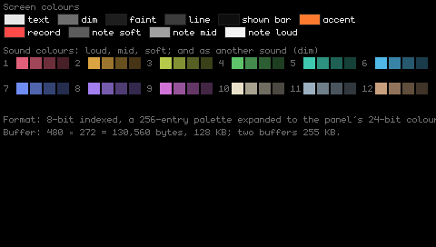
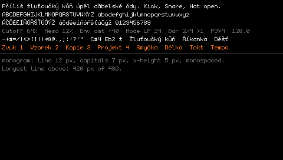

## The header

One text row at the top of every screen, 13 px, with a 1 px line under it; 15 px in all. Accepted by
the owner "for now", expected to change with testing.

- **Where you are**, at the left, items 6 px apart: the screen name in the accent (Step), the page
  name after it where the screen has pages (Sound Filter), the track (T1), the sound (Snare; in red
  when its sample is missing; while an empty pad is selected there is no sound to name, and the
  pad's dim number stands in its place, as an unselected empty pad's number does in STEP's names
  column **(my call)**), and the pad mode (Pads, or Keys C4 with the octave). STEP and ROLL name the
  screen only, not the SOUND page their strip shows. While the transport shows, a sound name that
  would bring this group closer than 6 px to the transport loses its end to "…".
- **The transport**, pushed to the right edge, from the left: the pattern (P3; P3→4 while pattern 4
  is queued), the bar the step buttons show over the pattern's length (2/4; "2/4 ▶1" while playing,
  the bar playing after ▶), the tempo with one decimal (120.0); then only while they apply: a record
  dot after the tempo, dim while armed (the count-in included) and red while recording, a disc 7 px
  wide whose rows are 3, 5, 7, 7, 7, 5 and 3 px wide, centred, on the same rows as the metronome
  icon; a small metronome icon while the metronome is on, dim, 7 px wide and drawn on the capitals'
  rows 4 to 10; "Mute 2 4" while tracks are muted, dim and at the right end after the metronome
  icon, counted in the room that shortens a sound's name like the rest of the transport. The items
  are 6 px apart and the last one ends at x 475.
- **A message** replaces the transport group, in red for errors (Storage full. Not saved; kick.wav
  not imported: library full; Library can't be read) and in the accent for notices (2 samples
  missing; Loading library; No unused sounds), until a later press of a button clears it **(owner's
  choice)**:
  - The presses that clear it are the 22 function buttons, a step and an encoder push. The press
    that caused the message does not count, and the clearing press still acts. Pads, MIDI notes,
    turns and the volume do not clear it.
  - A progress message stays while its work runs, then its result shows. A new message replaces the
    shown one. Nothing times out.

Rejected: every item spread evenly across the width (the groups get lost); a two-line header.

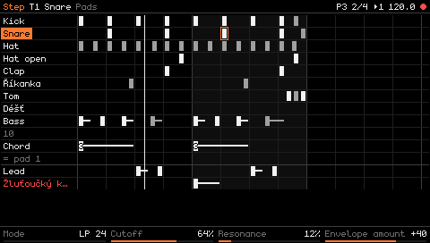
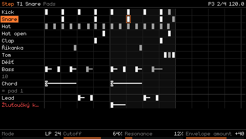
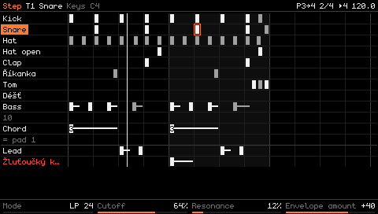
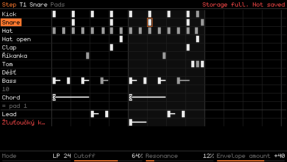

## The strip

A 1 px line, then four cells of equal width (120, 120, 119, 119 px), each holding the parameter item
its encoder holds, when it holds one: name at the left, value at the right, 3 px inside, the 2 px
bar under them; 19 px in all, at the bottom of every screen. An empty cell draws nothing, and where
the encoders hold nothing (a list screen, a picker, a question) all four are empty; the line and the
19 px stay, so the main area never changes height **(owner's choice)**. The NOTE strip (Pitch,
Velocity, Length, Position) and the timing strip (Tempo, Grid, an empty cell for Swing, Quantize)
are the same cells with other items. Where the held notes differ, a NOTE strip value is a range: the
lowest and the highest joined by an en dash, such as "C3–E3", "60–100", "1/16–1/8" and "−1–+2", the
minus being the signed values' minus sign. The bar under a single Pitch or Velocity fills by its
value out of 127; under a range, under Length and under Position it is the bare track
(`note-strip.png`).

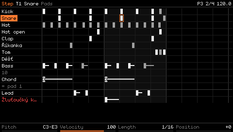
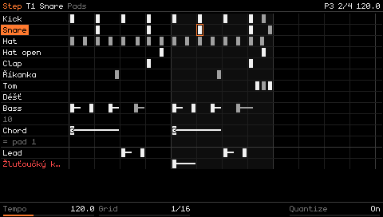

## STEP

**Scale** **(owner's choice)**: 8 px per sixteenth, so 3.5 pages of 16 are visible in 4/4. 12 and 10
px were drawn and rejected.

**Lanes.** A compact list of 13 px rows with 1 px gaps (14 px pitch), top-aligned 2 px under the
header's line; empty space below the lanes stays empty. The names column at the left: 3 px, the
widest label of all the track's lanes, up to 12 characters, 3 px; the lanes scrolled out of view
count too, so the grid never moves while the view scrolls. A pad lane's label is its sound's name,
"= pad 1" dim where an earlier pad holds the same sound (a copy lane, Workflow B) or an empty pad's
number, dim; an extra lane's is its sound's name; a missing sound's name is red. A label of more
than 12 characters ends in "…" and never scrolls. The label of the lane the cursor is on is
inverted, exactly that 3 px frame around the word: the selected sound's name and so also a selected
copy lane's "= pad 1" and a selected empty pad's number **(owner's choice)**. The grid's area is
pushed to the right edge.

**Pages of 16.** The screen draws the same pages the step buttons show: a bar shorter than 16
sixteenths leaves dark cells after its end, a longer bar continues on a second page. 3/4 is 12 cells
and 4 dark; 7/8 is 14 and 2 dark; 5/4 is a full page, then 4 cells and 12 dark. Dark cells are
filled faint. The page the step buttons show is tinted. Bar lines in the line grey, beat lines and
page starts faint, faint separators between lanes, a brighter line above the extra lanes. The grid
ends with the pattern: no cell or grid line is drawn past the last bar's last page, and the bar line
where the next bar would start closes it, so a pattern too short to fill the grid leaves the rest of
the row empty but for the lines between lanes, which run on to the grid's right end **(owner's
choice)**.

**Notes.** Each note is drawn at its real start and end **(owner's choice)**, 60 ticks a pixel, so
480 ticks, a step, are 8 px. Its start and its end, counted from the line at the left of its cell,
are each rounded to the nearest whole pixel, a half rounding up, so every edge is crisp. Its first
pixel is 2 px right of the line at its start and its last is 2 px left of the line at its end, which
leaves 1 px clear beside each line, so an on-time note whose length is a whole number of steps looks
as before: 5 px wide for one step, 13 px for two. The first 5 px are the block, 11 px tall in the 13
px row, in three greys by velocity; the rest is a tail 2 px tall on the block's middle rows. A note
is never drawn narrower than the block, so a short tap stays visible. A cell with several notes
draws one block from the earliest start to the latest end, with a chord's count from 2 to 9 as a
digit on the block (5 px, no side padding at this scale), and none for 10 or more, since two digits
do not fit. Nothing is drawn past the grid's end, where the pattern or the screen ends: a tail stops
2 px before the line that closes the grid, and a block that would cross that line moves left to end
on it, still 5 px wide. A note belongs to the step whose sixteenth it starts in, so a slightly early
loose hit belongs to and lights the step before the one aimed at, though it is drawn where it was
played, and nothing is drawn left of centre. `step-playing.png`'s left-shifted note is older than
this choice, which the text overrules.

**The music** is a 1 px white line. **The cursor** is the orange outline around the cell, 1 px
outside it.

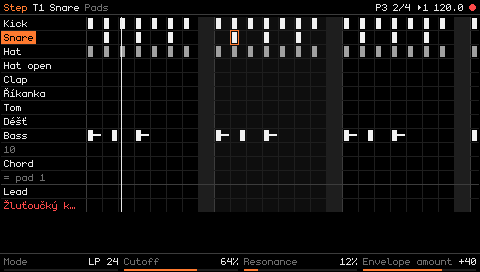
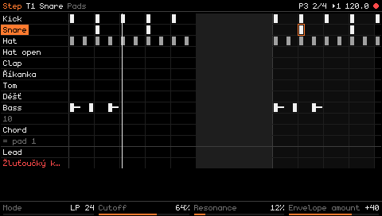

Open: whether bars should instead be drawn edge to edge at their true length, which would be a
Workflow B change; whether the chord digit stays legible on the panel.

## ROLL

One 13 px row per semitone for every pitch a note can have, from C−1 at the bottom to G9 at the top,
16 rows on screen as STEP has 16 lanes, from the same 2 px under the header; STEP's grid, pages,
tint, cursor and music line. Every note of the track in its sound's colour, the selected sound's
notes bright by velocity and the others dim (see "Colour"), the other sounds' notes drawn first and
the selected sound's last so it is on top; drums sit on their root row.

**The names column.** At the left, each row's pitch name in Root note's format ("C4", "C#4", "C−1"),
the sharps dim and the others in the text colour, 3 px from the screen's edge. As on STEP, it is as
wide whatever rows show: 3 px, the widest name ("C#−1") and 3 px: 29 px in all, so the grid has room
for 55 cells and its left line is at x 38. The lines between rows run as on STEP: faint, and in the
line grey between each B and the C above it, which marks each octave (`roll.png`).

**Notes.** A note is a block from its exact start as long as the note, drawn by STEP's rule (see
"Notes" under STEP): its start and its end each at 60 ticks a pixel, counted from the line at the
left of its cell and rounded to the nearest whole pixel, a half rounding up; its first pixel 2 px
right of the line at its start and its last 2 px left of the line at its end, never fewer than 5 px
wide; 11 px tall in the 13 px row, with no tail and no count. Its end lies in the bar and sixteenth
of its last tick, so a note that runs on into the next bar ends where that bar shows it while one
that ends with its bar ends there. A note that starts before the first shown cell runs in from the
grid's left line, and nothing is drawn past the grid's end, as on STEP.

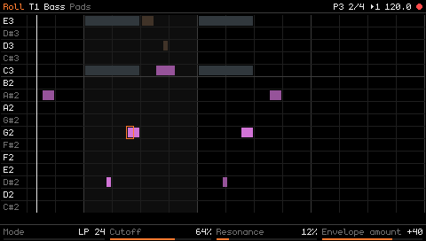

## Shared parts

- **MENU held** and **PAGE held**: the main area becomes 16 tiles in 4 columns for the 16 step
  buttons, each with its number and its name, the current screen or page outlined in the accent,
  empty tiles outlined faint.
- **A picker** replaces the main area with a list of 13 px rows, the cursor an outline as
  everywhere, the strip empty since the encoders do nothing in a picker: the sound picker lists
  Empty, New sample, New synth, then the pool with each sound's engine, a missing sound in red; the
  sample picker has a dim top line that names the folder and shows the library meter (how full the
  library is, the same number as on POOL and SAMPLES), "drums/ Library 41.2 of 64 MB", the folder
  losing its start to "…" when too wide; at the top level it reads "Library 41.2 of 64 MB". Under it
  are 15 rows at every level, folders and files with length and size; every file can be chosen.
- **A question** is a box with a 1 px outline in the middle of the main area: the question, its
  count and what OK and Cancel do; the strip is empty while it is open. POOL's two questions:
  "Delete Kick?" (text), "On 2 pads, 24 notes" (dim; "On 1 pad" for one), counting every track and
  left out when nothing uses the sound; and "OK deletes, Cancel keeps" (dim), as in `question.png`;
  "Remove 3 unused sounds?" or "Remove 1 unused sound?" (text) and "OK removes, Cancel keeps" (dim).
  With no unused sound there is no question: the header says "No unused sounds" in the accent.
- **The NOTE panel** is a box over the main area of STEP or ROLL, as a question's is: 124 × 77 px at
  x 178, in the middle of the main area (y 96), filled black with a 1 px outline in the line grey.
  It holds the cell's four values as parameter items, 118 px wide and 18 px apart from (181, 99),
  the cursor on one as an outline around the item; the cell's own outline stays where it shows under
  the box. The items carry no encoder numbers, which belong to a page's items. The bar under a
  single Pitch or Velocity fills by its value out of 127; otherwise it is the bare track, as in the
  NOTE strip. The strip shows the same four items, since the encoders hold them while the panel is
  open. `note-panel.png` sits 1 px higher and fills Length's and Position's bars, which this text
  overrules.

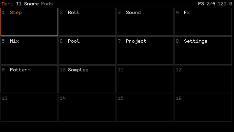
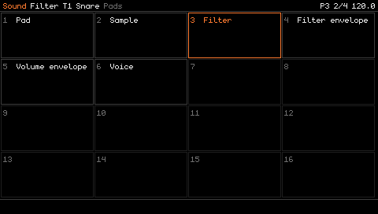
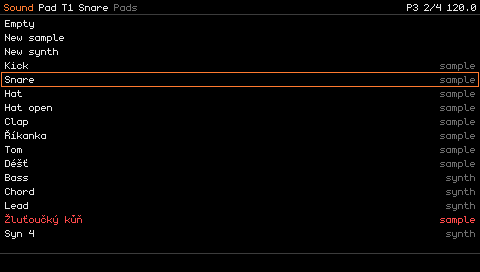
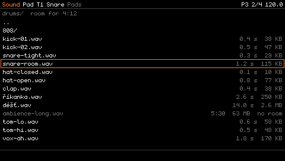
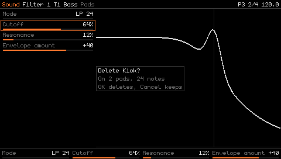
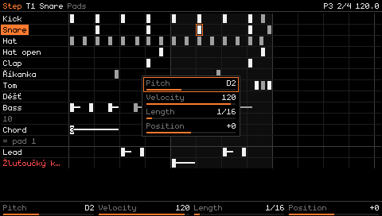

## The other screens

**A page** is its items in one column at the left, 160 px wide with the cursor on one, as many as
the page has, and a picture at the right where one helps; the strip repeats the items the encoders
hold, which carry their encoder's number. Thirteen items fit under the header; a longer page scrolls
like a picker: the cursor never leaves the screen, and the column moves one item when the cursor
reaches its last fully visible item, while the picture stays put **(owner's choice)**. No part 1
page is longer than eight items. **Pictures are cheap and informative only** **(owner's choice)**:
the Pad page shows the track's twelve pads as tiles, each with the pad's number and its sound's
name, an empty pad with its number only and the selected pad in the accent; a sample page shows the
waveform with the start and end marks; an envelope page shows the envelope's shape; a filter page
shows the filter's curve with a faint line at the cutoff. Richer graphics come later.

- **SOUND**: the seven pages Workflow A lists (Pad, the engine, Filter, Filter envelope, Volume
  envelope, Voice, Pitch), each drawn this way, each a whole group: Filter is seven items, the
  sample engine eight.
  - **The sample page's points.** Start, End, Loop start and Loop end are frames of the sound's file
    and show a percent of its length with one decimal, "4.2%", so every fine click shows;
    `sound-sample.png` shows whole percents.
  - **The waveform** has one line per column of the picture: the highest absolute sample, of both
    channels, among up to 64 frames spread evenly over the column's share of the whole file, so the
    work per file is bounded. It is drawn as a vertical line in the note mid grey, symmetric about a
    faint middle line, with its half height 2 px less than half the area's at full scale. Start and
    End are full-height accent lines.
- **FX, Chain**: the six slots as a row of tiles in chain order, empty slots faint; under them Type
  and Move for the chosen slot, the one the cursor last stood on, on encoders 1 and 2. A tile is 77
  by 19 px, slot _s_ counted from 0 at (2 + 79 _s_, 17), so that the cursor's outline clears the
  header's line and the screen's edge and a dark pixel stays between it and the next tiles
  **(owner's choice)**: a used slot's border in the line grey and an empty one's faint, its number
  dim 3 px in and its effect's name in the text colour 14 px in (`fx-chain.png`). The chosen slot's
  tile has its border, number and name in the accent whatever the cursor is on, as the Pad page's
  selected pad does, and while the cursor is on the tiles it has the cursor's outline 1 px outside
  it as well. Type and Move are items 160 px wide from (2, 39), 18 px apart. `fx-chain.png` is older
  than the cursor's outline and shows the tiles 1 px wider, higher and further left, with no
  outline, which the text overrules. The slot pages are ordinary pages with all of the effect's
  settings; an empty slot's page and strip are empty.
- **MIX**: one page: the four track levels as items, a muted track named in red, then Master; the
  encoders hold the four track levels **(owner's choice)**. A muted track's item reads "Track 3
  muted" with its name in red, and its strip cell reads the same in the strip's usual colours
  (`mix.png`).
- **SETTINGS**: a first page named **Playing** (header "Settings Playing", tile "1 Playing") with
  Velocity, Metronome, Metronome level and Count-in as items, each on the encoder of its place, 1 to
  4 **(owner's choice)**; Count-in is a list, so turns, − and + move it and OK does nothing; and a
  **Dev page** (tile "2 Dev") with library and note memory as items with bars, so the device itself
  has them and the hardware later shows them in the same place; meters are not set, so the encoders
  hold nothing there and the strip is empty **(owner's choice)**. The "Note memory" item sits under
  Library and reads "0.0 of 8 MB" when empty, in the library meter's format, with its bar; it counts
  520 bytes for each block in use, the block and its bookkeeping.
- **POOL**: Remove unused first, with no label; then every sound in number order, its name at the
  left and a dim label at the right: the engine word (for a missing sample "missing" and the file's
  name), the pads and a loaded sample's size, two spaces apart (`sample  pads 1, 12  38 KB`,
  `synth  pad 9`; `pool.png`). The pads are the current track's pads that hold the sound, in pad
  order ("pad 2", "pads 1, 12"), "no pad" when none does and "no pad, no notes" when nothing uses
  the sound on any track. A missing sound has its whole row in red and no size
  (`sample  missing kick.wav  no pad`); the file's name is the last part of its path, or the library
  file's name, and a long one is shortened with "…" so that the label takes at most half the row,
  the name keeping at least its "…" **(owner's choice)**; `pool.png` and the POOL behind
  `question.png` are older than that choice and show a missing sound without the file's name, which
  the text overrules. The library meter is an item above the strip ("Library", "41.2 of 64 MB" and
  the 2 px bar), the same number as on SAMPLES and in the picker; the strip empty.
- **PROJECT**: New first, then the projects, the open one marked "open", an old-format one marked
  "old format" in red; the strip empty.
- **PATTERN**: Timing and Bars as pages (headers "Pattern Timing" and "Pattern Bars"); Timing,
  PAGE + 1, holds Tempo on encoder 1, Grid on 2 and Quantize on 4, a switch that OK flips, with
  encoder 3 holding nothing until Swing is built, so the timing strip's third cell stays empty;
  Bars, PAGE + 2, holds Length on 1 and Signature on 2; the Patterns page lists New, then every
  pattern with its bars and note count, playing and queued marked, empty ones dim; its strip empty.
- **SAMPLES**: the library by folder, in the sample picker's order, with a folder as its name and
  "/" and a file as its stored name with ".wav", its length and size dim at the right; a file
  start-up could not load in red with "not loaded". Inside a folder a dim line names the folder and
  the first row is "..", as in the picture of the sample picker; at the top level both are left out.
  A folder line too wide for its row is cut at its start with "…", as in "…808 collection/long
  names/", so the folder you are in always shows **(owner's choice)**. The library meter is an item
  above the strip ("Library", "41.2 of 64 MB" and the 2 px bar, full width), never a cursor target;
  the strip empty.

Rejected: a CPU meter on the Dev page **(owner's choice)**; a measured time comes from a clock
outside the core and differs per machine and per run, so a frame showing it could never be
identical. CPU cost is tracked by instruction counts in fixed scenes in the test harness
(Foundation) and later measured on the hardware, not shown on the device in part 1.

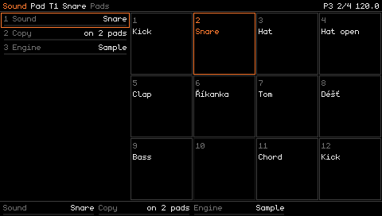
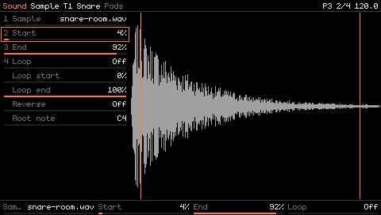
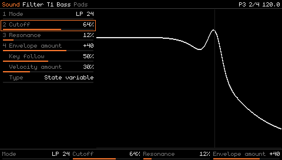
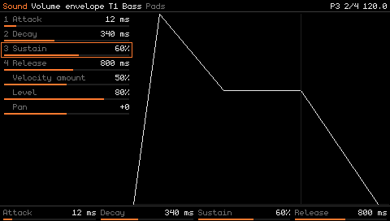
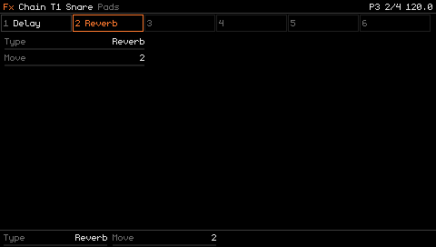
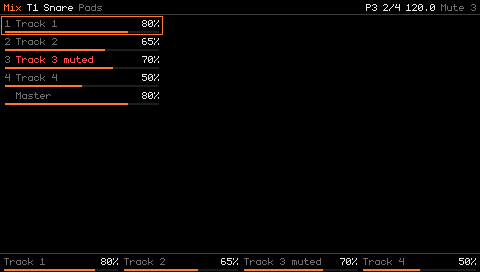 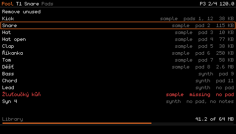
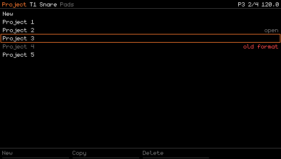
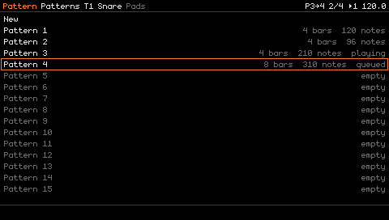
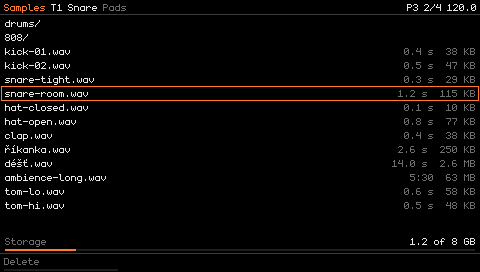

## The panel

**(owner's choice)** The owner composed the layout from a survey of 33 devices; layout D was only
the starting arrangement. 321 × 128 mm:

- **Top left**: the volume encoder; under it one row REC, PLAY, STOP, TEMPO, level with the right
  section's lower key row.
- **Top middle**: the display, centred between the two sections.
- **Top right**: the four encoders in a row (25 mm pitch), which mirrors the strip's four cells;
  under them two rows of keys: T1, T2, T3, T4, PADS/KEYS; ROLL, MENU, PAGE, COPY, SHIFT.
- **Bottom**: the 16 step buttons (15 mm pitch) over the 12 pads (20 mm pitch, 17 mm faces), with
  the navigation cluster at their right end: −, ▲, +, OK over ◀, ▼, ▶, CANCEL (15 × 20 mm keys), OK
  above CANCEL so that CANCEL + pad is a one-hand gesture for the right-hand pads. The keys of the
  browser's panel label the arrows ▲ ▼ ◄ ►, the four triangles text fonts carry together, since ◀
  and ▶ come from the emoji block and fall back to another font **(owner's choice)**.
- **No STEP button**: STEP is MENU + 1 only. ROLL keeps its button. 22 function buttons, the four
  encoders with push switches, the volume encoder, 16 steps and 12 pads.

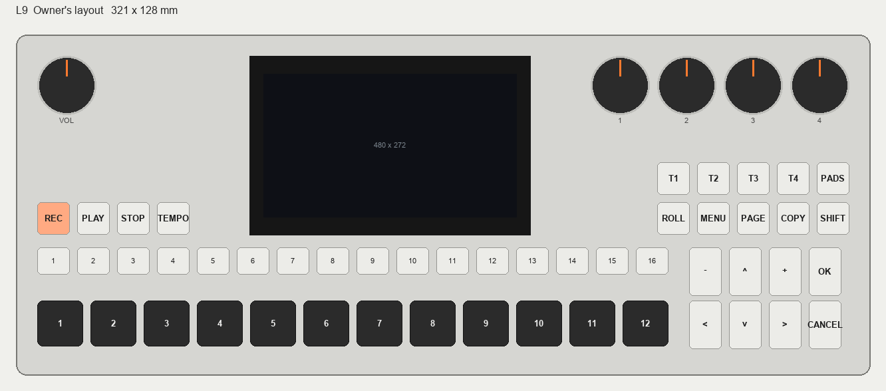

From the survey: the owner's hand model, right hand on the pads and left hand on transport and
modifiers, is the model of Maschine, Teenage Engineering, Roland, Elektron and Arturia; no device
puts a cursor cross at the end of a pad row (all nine with a cross put it beside the screen), so the
cluster's position is the one new thing; SHIFT touches transport on 11 devices; the volume is
top-left on 16 of 33; a row of four encoders beside the screen mirrors a strip of four on the OP-1
and OP-XY.

## The lights

**(owner's choice)** Single colour, on or off. Dimming is used only if the hardware gives it for
free, so nothing may depend on it. The EP-133 lights only its pads and group keys and shows
everything else on its display; this device does the same, lighting only what the screen cannot show
while the eyes are on the hands.

| Light           | On                                                                                                                                                                                                                                                                                       |
| --------------- | ---------------------------------------------------------------------------------------------------------------------------------------------------------------------------------------------------------------------------------------------------------------------------------------- |
| T1–T4           | the selected track; a muted track blinks slowly, selected or not                                                                                                                                                                                                                         |
| REC             | blinking with the beat while armed, lit while recording                                                                                                                                                                                                                                  |
| PLAY            | while playing                                                                                                                                                                                                                                                                            |
| TEMPO           | while the metronome is on                                                                                                                                                                                                                                                                |
| ROLL            | while ROLL is the screen                                                                                                                                                                                                                                                                 |
| PADS/KEYS       | in Keys mode                                                                                                                                                                                                                                                                             |
| Step buttons    | where the selected sound has a note in the shown page; the step under the music flipped for its sixteenth; steps past a short bar's end off. SHIFT held: patterns 1–16, lit with notes, the playing one lit, the queued one blinking. MENU or PAGE held: the screens or pages that exist |
| Pads            | the selected pad (pad 1, the C, in Keys mode); a pad is also lit while one of its notes is on: from a hit to its release and from a sequencer note's start to its end. CANCEL or COPY held: the pads that would be erased or copied blink                                                |
| Everything else | no light: STOP, SHIFT, MENU, PAGE, COPY, the arrows, OK, CANCEL, − and +                                                                                                                                                                                                                 |

The slow blink is once a second: half a second on, half a second off, at any tempo and while stopped
**(owner's choice)**. It counts from sample 0 of the audio clock and is on for the first half of
each second, so every muted track blinks together. The fast blink goes with the beat **(owner's
choice)**: on for the first half of each beat at the current tempo and off for the second, the beat
being what the signature counts, a quarter in x/4 and an eighth in x/8. REC armed uses it, and a
queued pattern's step button will use the same speed. While stopped, the beats run at the current
tempo from the press that armed REC, and a tempo turn while armed carries the beats on at the new
tempo from the first tick after the turn; during the count-in they are the clicks' beats, and at the
first beat REC turns steady.

Unless CANCEL or COPY is held, a pad lit by its selection or by a note does not blink. While one is
held, every pad it would erase or copy blinks, the selected pad included. The control part works the
pad lights out **(owner's choice)**.

T1 and pad 1 stay lit while "Loading library" shows **(owner's choice)**.

With dimming, pads with a sound are dim and the selected one bright, and the five black-key
positions are dimmer in Keys mode.

## The browser shell

The shell shows the screen and the panel and turns input into the abstract controls Foundation
defines: presses, releases, encoder turns, pad hits and MIDI notes with the audio clock's time
stamp. The core decides taps and holds; the shell never does.

- **The panel: two views and a switch (owner's choice, 2026-11-24).**
  - **The browser view**, the default, is made for playing in the browser. It is not the device's
    arrangement: the same controls with the same labels, behaviour and computer keys, arranged to
    fit the window. Its blocks are the screen; the four encoders, one under each of the screen's
    four strip cells; three rows of eight keys (T1, T2, T3, T4, PADS/KEYS, ROLL, a free cell and VOL
    as a smaller knob; REC, PLAY, STOP, TEMPO, −, ▲, + and OK; MENU, PAGE, COPY, SHIFT, ◄, ▼, ► and
    CANCEL), so OK stays above CANCEL; the 16 steps in two rows of eight; the 12 pads in two rows of
    six; then the row with the status line and the buttons. The rows of keys, steps and pads go
    under the screen and its encoders (a phone held upright) or in a column beside them (a phone
    held sideways, a laptop, a monitor), whichever gives the screen the larger zoom, and on a tie
    the larger keys. The screen takes the largest whole zoom that leaves every played control at
    least 44 CSS px; on a phone too narrow for that, the controls go down to 40 px before the screen
    drops a zoom. The keys, steps, pads and encoders then grow in CSS px, not tied to whole pixels,
    to fill the rest. The page fits the window with no scrolling; only a window too small even for
    the screen at zoom 1 with 40 px controls scrolls.

    How they grow **(my call)**: a key or a pad is at most as tall as wide, a step as flat as the
    device's 12 × 10 mm step but at least 40 px tall and an encoder at most as wide as a pad. A
    knob's label sits on the knob, as nothing is under it. The row with the status line and the
    buttons, in 12 px text, is as tall as its text wraps at its width; the shell measures it each
    time it fits the panel and fits the panel again when the row's text changes its height.

  - **The real-size view** draws the device as "The panel" measures it, 321 × 128 mm, at its true
    size on this screen. A browser cannot tell how big its CSS px is, so the first time the view
    shows a bank card outline (85.60 × 53.98 mm) with − and + to make it smaller or bigger until it
    matches a real card held against the screen, and Done. The browser keeps the size, in CSS px a
    mm, in its local storage; "Set size" shows the card again, and a blocked storage only means
    setting it again. − and + change the size by 1% a press and sit left of the card, where its
    growth does not move them **(my call)**. The screen picture is scaled by whatever fraction the
    size needs, so it is not pixel-exact, and the note in the row says so. A device wider than the
    window scrolls.
  - **The switch** is a button in the row with Save session and Save picture: "Real size" in the
    browser view and "Browser view" in the real-size view. The browser keeps the choice in its local
    storage in the same way. Switching only draws the panel again, as a resize does: the core, the
    lights and what is held go on.
- **Starting sound (owner's choice).** A browser is silent until the first click or key, so the
  status line says "Click to start" until then. It starts the row with the buttons, which sits under
  the pads or, when the rows are beside the screen, under the encoders; at real size it sits under
  the device.
- **Mouse (owner's choice).** Clicking a drawn key presses it, releasing lets go, so holding the
  mouse button holds the key. A pad or a key on the panel is held from mouse down to mouse up,
  wherever the pointer goes. A pad is hit at velocity 127 with no pressure. A mouse cannot hold one
  key and press another, so every two-key combination needs the keyboard for the held key.
- **Encoders by mouse (owner's choice).** The pointer is captured while the button is down. Each 4
  CSS px up from the press point is one click right and each 4 px down one click left; there is no
  acceleration. A release after less than 4 px and no click is a push: a press and a release at the
  release's moment. The volume knob has no push. The wheel adds up: 100 px of pixel delta or 3 lines
  is one click.
- **Touch (owner's choice).** Pointer Events are tracked per `pointerId`, so each finger is its own
  pointer, and the panel has `touch-action: none`. Nothing else is touch-specific.
- **Computer keyboard (owner's choice).** Keys are mapped by position (`KeyboardEvent.code`), all in
  code and expected to change:
  - pads on Z S X D C V G B H N J M, from C to B, at velocity 127 with no pressure, held from key
    down to key up;
  - steps on 1–8 and Q–I;
  - T1–T4 on O, P, `[` and `]`, and PADS/KEYS on `\`;
  - ROLL on K, MENU on L, PAGE on `;`, COPY on `'` and SHIFT on either Shift key;
  - PLAY on Space, REC on `,`, STOP on `.` and TEMPO on `/`;
  - OK on Enter; CANCEL on Escape; − and + on the − and = keys and on the numpad's − and +; the
    arrows on the arrow keys;
  - no encoder keys. Free: A, F, 9, 0, the backtick and Tab.

  A key with Ctrl, Alt or Meta held is ignored, and only mapped keys lose their browser default. Key
  repeat is ignored, so a held key is one press. Every combination works, since keys can be held
  together.

- **USB MIDI (owner's choice).** Every input on every channel is used, including devices plugged in
  later. Notes reach the core as notes with the hit's velocity, and the core maps them by the pad
  mode (Foundation); a note-on with velocity 0 is a note-off. Channel aftertouch becomes the
  pressure of every held pad, polyphonic aftertouch of its own pad. CC 20–23 turn encoders 1–4 and
  CC 7 sets the volume. A constant per number in the shell sets whether it is absolute, the default,
  or relative. Relative: 1–63 turn up and 65–127 turn down by 128 − value. Absolute: the difference
  from the last value is that many clicks, and the first value only sets the reference. MIDI is
  asked for at the "Click to start" gesture; if it is refused, the status line says "MIDI not
  allowed". Nothing else is mapped in part 1.
- **Losing focus (owner's choice).** On `blur` or when the page is hidden, the shell sends an
  ordinary release for every control that a key or a pointer holds: a drag ends and sends no push.
  MIDI notes stay.
- **One control, several sources.** The shell sends one press when the first source, a key or a
  pointer, takes a control and one release when the last lets go, so the core sees one physical
  control **(my call)**.
- **Save picture (owner's choice).** A "Save picture" button beside "Save session" saves the shown
  frame through the core's palette at 4× (1,920 × 1,088) as `screen-<audio sample>.png`.
- **Files.** Dropping WAV files or a folder onto the page hands them to the core, which imports them
  into the library as the Project model says; the header shows "Importing 3 files", or "Importing
  kick.wav" for one, in the accent while it runs, and presses do not clear it. A drop that arrives
  meanwhile joins it ("Importing 5 files"). Then the result: "3 files imported" or "kick.wav
  imported" in the accent, or in red "2 files imported, 1 not: library full" or "kick.wav not
  imported: library full". The reasons are library full, storage full and can't be read, each listed
  once in that order: "5 files imported, 3 not: library full, can't be read". A name too long for
  the header is shortened with "…" so that the rest of the message shows; a message still too wide
  for the room right of the header's left pieces is shortened with "…" before it reaches them, so it
  never draws over the screen name **(owner's choice)**. A refused file does not stop the ones after
  it **(owner's choice)**.
- **What the shell never does:** draw anything of its own on the screen, decide a tap or a hold,
  latch a modifier, or scale the screen by a fraction outside the real-size view **(my call)**.

## The screen gallery and the drift frames

The gallery (Foundation) shows every screen in fixed states. Its first states are the 27 screens in
`2026-11-07-groovebox-look/`: STEP playing, stopped, queued in Keys mode, with a message, in 7/8 and
in 5/4; ROLL; SOUND's Pad, Sample, Filter and Volume envelope pages; FX Chain; MIX; POOL; PROJECT;
PATTERN's Patterns page; SAMPLES; MENU held; PAGE held; the sound and sample pickers; a question;
the NOTE panel; the NOTE strip; the timing strip; the palette; the font test. The first
implementation of each screen is compared against its picture by eye, and the drift tests' expected
frames are first recorded from the implementation that matches.

## Testing

On top of the other specs' testing:

- **Ordinary tests**: the layout rules as pure functions (text rows 13 px, items 17 px, the cursor 1
  px outside, 2 px container padding, 1 px elsewhere); shortening with "…", including a folder line
  cut at its start and a header message cut before the left pieces; bar fills rounded to the nearest
  pixel at their boundaries; scrolling text: only under the cursor, the pause, a pixel at a time,
  the loop and its gap, the cut at the box's edges; the header's content per state; the library
  meter showing the same number on POOL, SAMPLES and in the sample picker; the strip's cells, empty
  on lists, in pickers and in questions; the encoder marks on a page; a page's scrolling; STEP's
  page arithmetic in 4/4, 3/4, 7/8 and 5/4; ROLL's rows; the palette's entries; the keyboard and
  MIDI maps; tap-and-hold forwarding.
- **Drift scenes**: every gallery state captured as a frame.
- **The gallery** itself, with the PNGs beside it.

## Changes to the part 1 overview

Applied to the overview together with this spec:

- The Look part of the decision register points to this spec; its open questions are answered here.
- Layout D is replaced by the owner's layout; the STEP button is gone (MENU + 1).
- The milestone "the panel drawn from data" reads "the panel drawn from code".
- The glossary gains the cursor outline, the selected block and the Dev page.

## Changes to the other specs

Applied in the consistency pass of 2026-11-10. Where a decision of that pass differs from a bullet
below, the target spec's current text holds.

- **Foundation**: the frame buffer is 8-bit indexed with a 256-entry palette, 128 KB (255 KB for
  two), in the budget profile; the drawing interface is fills, lines, outlined rectangles and
  glyphs; the colour palette is code, as decided.
- **Workflow A**: STEP has no button and is MENU + 1; the header names the page after the screen;
  pickers show their highlight as the cursor outline; "Sound 4" style page numbers become page
  names, and with pages as whole groups there is no "Filter 1" and "Filter 2", only Filter; SETTINGS
  gains the Dev page.
- **Workflow B**: "pressing STEP while on STEP follows again" becomes "pressing PLAY while playing
  follows again" **(owner's choice)**; the screen draws the pages of 16 exactly as the step buttons
  show them, confirmed; the header's layout as above.
- **The Project model**: nothing.

## Assumptions about parts 3 and 4

- **Part 3**: a 4.3″ 480 × 272 IPS panel with a 24-bit RGB parallel interface and an LCD controller
  peripheral to stream it; four endless encoders with push switches and a fifth for the volume;
  single-colour LEDs under the pads, the step buttons, T1–T4, REC, PLAY, TEMPO, ROLL and PADS/KEYS,
  on and off at least; 12 velocity and pressure sensitive pads at 20 mm pitch; 16 step keys at 15
  mm; keys at 15 mm pitch; a panel of about 321 × 128 mm.
- **Part 4**: the layout above as the front face; the EP-133 and OP-XY as the design references for
  keycaps, legends and finish.

## Research sources

- **Displays**: Newhaven NHD-4.3-480272EF-ASXP, Riverdi RVT43HLTFWN00, Crystalfontz
  CFAF480272H0-043SN, 4D Systems 4DLCD-43480272-IPS, Winstar WF43WTWAEDNN0, Displaytech DT043BTFT
  and Adafruit 1591 datasheets and product pages; the 800 × 480, 5″ and 3.5″ classes from the same
  vendors (`research-displays.md` in the brainstorm's scratchpad).
- **Font**: [monogram](https://datagoblin.itch.io/monogram) (CC0); the `.fnt` files in this repo.
- **EP-133 K.O. II**: the official guide pages hardware overview, screen, buttons and combos, modes,
  functions, play and record, system, what's new, and the product page.
- **Pixel screens**: the Dirtywave M8 manual and the m8c client; the OP-XY guide; the Polyend
  Tracker+ and Play+ manuals; the FL Studio piano roll manual; the FastTracker II clone and Schism
  Tracker sources; the EGA and VGA palettes.
- **Panels**: 33 devices' official manuals, guides and panel drawings: Teenage Engineering EP-133,
  OP-XY, OP-Z, OP-1 field; Elektron Digitakt II, Digitone II, Syntakt, Analog Rytm MKII,
  Model:Samples; Akai MPC One+, Live II, Key 37; Native Instruments Maschine+, Mikro MK3; Synthstrom
  Deluge; Polyend Tracker+, Play+; Novation Circuit Tracks, Rhythm; Roland MC-707, MC-101,
  SP-404MK2, TR-8S; Korg electribe 2, drumlogue; Dirtywave M8; Ableton Move, Push 3; Squarp Hapax;
  Yamaha SEQTRAK; Arturia BeatStep Pro; 1010music blackbox; Sonicware Liven.
