# Groovebox part 1 – Look and panel

Status: design, approved by the owner section by section. The sixth and last of six subpart specs of
part 1; see [the part 1 overview](./2026-10-26-groovebox-core-browser-design.md) for the intent, the
goals and the decision register, [Foundation](./2026-11-02-groovebox-foundation-design.md) for how
the core draws and what it may use, [Workflow A](./2026-11-03-groovebox-workflow-a-design.md) and
[Workflow B](./2026-11-05-groovebox-workflow-b-design.md) for what every screen shows and what every
control does, and [the Project model](./2026-11-06-groovebox-project-model-design.md) for the marks
and messages the screens carry.

**Nothing here is final.** The look was designed by drawing every screen pixel by pixel with the
operations the core will have and changing it until the owner was satisfied; it will change again
as the device is played. This spec records the starting point. Layout, bindings, colours and the
panel are code, changed by editing code (Foundation).

Every section of this spec was presented to the owner as a drawn screen and approved. Points where
the owner chose between options or set a rule are marked **(owner's choice)**. Details settled
while drawing, which the owner has not objected to, are marked **(my call)**. The pictures in
`2026-11-07-groovebox-look/` are the approved screens at the display's own 480 × 272 pixels; they
are the first screen gallery and the first expected frames of the drift tests.

## What Look decides

The display part and what the browser imitates; the font; the rules every screen is drawn by; the
colours; how each screen, picker, question and panel is drawn; the panel layout with every control;
the lights; how the mouse, the computer keyboard and USB MIDI drive the controls; how sample files
get in; the development meters; and the screen gallery. It does not decide what the screens mean
(Workflows A and B) or what they store (the Project model). "Changes to the other specs" lists what
this spec alters in the earlier ones; "Assumptions about parts 3 and 4" lists what it hands to the
hardware.

## Decisions at a glance

| Topic           | Decision                                                                                                                                                  |
| --------------- | --------------------------------------------------------------------------------------------------------------------------------------------------------- |
| Display         | 4.3″ 480 × 272 IPS, a real part from many vendors in one footprint; nothing doubled (owner's choice)                                                       |
| Frame buffer    | 8-bit indexed, a 256-entry palette expanded to the panel's 24-bit colour; 128 KB per buffer                                                               |
| Font            | monogram, 7 px capitals, monospaced 6 px, every Czech letter, CC0 (owner's choice); mixed case; full names, shortened with "…" only when they do not fit   |
| Look            | Minimal and flat: black, no bevels, no shading, lines only where they carry meaning (owner's choice)                                                       |
| Spacing         | Every element sized to its content, 1 px gaps, free space between elements, 3 px around the capitals, text rows 13 px (owner's choice)                    |
| Cursor          | An orange outline 1 px outside the item, everywhere; the inverted orange block means only "selected" (owner's choice)                                     |
| Parameter item  | Name left, value right, a 2 px bar under them; the same in the strip, on a page and in a panel (owner's choice)                                            |
| Colour          | Black, three greys, one orange accent, red for recording and errors; twelve sound colours that belong to the sound, not the pad (owner's choice)           |
| Header          | One row: where you are at the left, the transport at the right, the page named after the screen; messages replace the transport group (accepted for now) |
| STEP            | 8 px per sixteenth, pages of 16 as the step buttons show them, 13 px lanes top-aligned under the header (owner's choice)                                   |
| ROLL            | One 13 px row per semitone, notes in their sound's colour, the selected sound bright by velocity, the others dim                                           |
| Pictures        | Cheap and informative only: the pad grid, the waveform with its marks, envelope shapes, the filter curve (owner's choice)                                  |
| Panel           | The owner's layout "L9", 321 × 128 mm: volume and transport top left, display in the middle, encoders and keys top right, steps and pads with the cursor cluster below; no STEP button (owner's choice) |
| Lights          | Single colour, on or off; dimming only if the hardware gives it for free (owner's choice)                                                                  |
| Meters          | A Dev page on SETTINGS (owner's choice)                                                                                                                   |
| In the repo     | This spec and a folder of PNGs, one per approved screen state (owner's choice)                                                                            |

## The display

**(owner's choice)** The display stays the 4.3″ 480 × 272 IPS panel the overview assumed, now
confirmed against real parts. Newhaven, Riverdi, Crystalfontz, 4D Systems, Winstar, Displaytech,
Adafruit and others sell it in one footprint: 95.04 × 53.86 mm of picture in a 105.5 × 67.2 mm
module, a pixel pitch of 0.198 mm, 24-bit colour in over a 40-pin ribbon. The class is not being
phased out; its older TN parts were replaced by IPS parts in the same outline, and an 800 × 480 part
in the same footprint exists as a later upgrade path. These panels have no memory of their own, so
the processor streams every frame, which needs an LCD controller peripheral of the kind the STM32H7
class has; that goes to part 3. The alternatives researched (4.3″ 800 × 480, 5″ 800 × 480, 3.5″
480 × 320) were rejected because the font would come out at 0.9 to 1.2 mm instead of 1.4 mm.

**Nothing is doubled** **(owner's choice)**. Every element is drawn in the display's own pixels. The
alternatives, doubling the font or doubling everything, were drawn and rejected: twelve lanes under
a header and above a strip do not fit with doubled text.

**Frame buffer.** 8-bit indexed, 480 × 272 = 130,560 bytes (127.5 KB), expanded through a 256-entry
palette to the panel's 24-bit colour, which loses nothing. Two buffers are 255 KB. This is the
Foundation candidate, confirmed; the budget profile gains it.

**Drawing operations.** Every screen in this spec was drawn with these and nothing else, so they are
the core's drawing interface: fill a rectangle with a palette colour; a horizontal or vertical
1-pixel line (a rectangle 1 pixel thin); an outlined rectangle (four lines); a glyph of the bitmap
font at a position in a colour. Curves and waveforms are columns of 1-pixel fills.

**In the browser** the shell shows the buffer on a canvas and zooms it by a whole number of the
monitor's device pixels, never by a fraction: on a desktop at 100% browser zoom and a 100% or 200%
display scale every screen pixel is an exact block. On other scales, and on phones, a browser
cannot show the picture pixel-exactly; the shell says so instead of pretending. For review away from
such a screen, the shell exports a screen as a PNG enlarged by a whole number.

## The font

**(owner's choice)** **monogram**, the bitmap font the Foam and Somewhere apps in this repo already
use (`apps/foam/build/client/monogram.fnt`), by datagoblin, CC0:

| Property        | Value                                                                                  |
| --------------- | -------------------------------------------------------------------------------------- |
| Capitals        | 7 px (1.4 mm on the panel); x-height 5 px                                              |
| Line            | 12 px including accents and descenders: capitals on rows 3–9, accented capitals 1–9, descenders to 11 |
| Width           | Monospaced, 6 px per character, 80 characters across the screen; every glyph leaves its sixth column blank |
| Glyphs          | 577, every Czech letter in both cases, the arrows ← ↑ → ↓, the triangles ▲ ▶ ▼ ◀, • and … |
| Variants        | italic, outline and italic outline, also in the repo, unused in part 1                 |

Kerning is not used; monospacing gives aligned digits for free. px sans nouveaux (MIT, proportional,
8 px capitals, also in the repo) was tried first and rejected as ugly.

**Mixed case** **(owner's choice)**. Sound names are shown as the files are called (Kick, Hat open,
Říkanka), labels like Cutoff, screen names like Step. The capitals of the earlier specs were a
writing convention, not a decision.

**Full names** **(owner's choice)**, never abbreviations: Resonance, Envelope amount. A label that
does not fit the space it has is shortened with "…": a long value keeps its label short ("Sam…"
next to a long file name), and a sound name longer than 12 characters is shortened in the names
column of STEP ("Žluťoučký k…") **(my call: 12)**.

## The rules every screen is drawn by

**(owner's choice)**

- **Minimal and flat.** Black background. No bevels, no shading, no fills except where they carry
  meaning; outlines and lines only where they are needed and useful; everything readable at a
  glance.
- **Spacing, in flexbox terms.** Every element is sized to its content; nothing grows; gaps and
  margins are 1 px; free space goes between elements (`space-between`), never into them. The
  screen has 1 px of padding.
- **Text.** Space around text is measured from the capitals, not from the font's bounding box,
  which would move with every accent and descender: 3 px above the capital line, 3 px below the
  baseline, and 3 px left and right of the glyphs' own pixels (monogram's blank sixth column does
  not count). A text row is therefore 13 px: 3 + 7 + 3. Accents reach 2 px above the capitals and
  descenders 2 px below the baseline, so an Ž or a y comes within 1 px of the row's edge; the text
  stays centred on the capitals whatever it contains.
- **A parameter item** looks the same everywhere: name at the left (dim), value at the right
  (bright), 3 px inside; under them, after 1 px, a 2 px bar across the item (a faint track, the
  accent fill), then 1 px; 17 px tall. In the strip, on a screen's page and in the NOTE panel
  alike. An empty item draws nothing.
- **The cursor** is an orange outline 1 px outside whatever it is on: an item, a cell, a list row,
  a picker row, a tile. It is the one "you are here" colour. Items and rows are 1 px apart, so the
  outline uses the gap.
- **A container whose content can carry the cursor** (an item list, the STEP lanes, the ROLL rows,
  a picker) has 2 px of padding: 1 px of space and 1 px for the outline, so the outline never
  touches the header's line or a box's border. Everything else keeps 1 px.
- **Selected** is the inverted orange block with the text in black: the selected sound's name on
  STEP. It is the only use of the block; the cursor never inverts.
- **Pictures** (grids of boxes, curves, waveforms) are graphics, not text: their area has 1 px
  margins, aligned with the neighbouring items' outline row and column.

## Colour

**(owner's choice)** The palette, as indexed entries:

| Role                   | Value                                            | Used for                                                        |
| ---------------------- | ------------------------------------------------ | --------------------------------------------------------------- |
| background             | `#000000`                                        | everything behind                                               |
| text                   | `#e8e8e8`                                        | values, names, labels                                           |
| dim                    | `#6e6e6e`                                        | parameter names, empty pads, copy lanes, sharps, empty patterns |
| faint                  | `#1e1e1e`                                        | beat lines, lane separators, bar tracks, dark cells, empty tiles |
| line                   | `#3c3c3c`                                        | bar lines, the lines under the header and above the strip, boxes |
| shown-bar tint         | `#0e0e0e`                                        | the page the step buttons show                                  |
| accent                 | `#ff7a2f`                                        | the cursor, the selected name, the screen name, bar fills        |
| record                 | `#ff4a4a`                                        | recording, errors, a missing sample, an old-format project      |
| note soft, mid, loud   | `#5c5c5c`, `#a0a0a0`, `#f2f2f2`                  | notes on STEP by velocity: below 60, 60 to 99, 100 and up       |
| sound colours 1–12     | `#e0607a` `#d9a441` `#b6c94a` `#5ec36b` `#3fc9b0` `#4fb8e6` `#6f8cf2` `#a27ef0` `#d173d6` `#e8e0c8` `#9ab0c0` `#c9a07e` | notes on ROLL; twelve hues of similar lightness, none orange |

**A sound's colour belongs to the sound, not the pad**: its pool number, cycling through the twelve,
so Kick keeps its colour wherever it sits. On ROLL the selected sound's notes are its colour at
three brightnesses by velocity (the colour mixed with black at 1, 0.72 and 0.48); every other
sound's notes are the same hue at 0.32. STEP stays in greys. The whole palette is about sixty
entries.

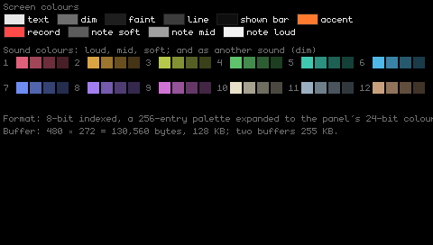
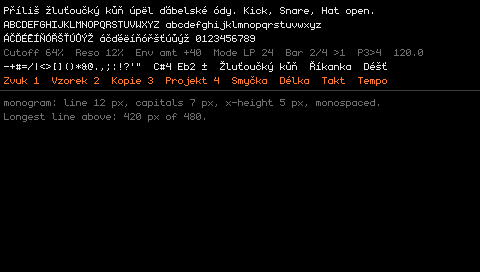

## The header

One text row at the top of every screen, 13 px, with a 1 px line under it; 15 px in all. Accepted
by the owner "for now", expected to change with testing.

- **Where you are**, at the left, items 6 px apart: the screen name in the accent (Step), the page
  name after it where the screen has pages (Sound Filter 1), the track (T1), the sound (Snare; in
  red when its sample is missing), and the pad mode (Pads, or Keys C4 with the octave).
- **The transport**, pushed to the right edge, right to left: the pattern (P3; P3→4 while pattern
  4 is queued), the bar the step buttons show over the pattern's length (2/4) with ▶1 for the bar
  playing, the tempo (120.0); then only while they apply: a record dot, dim while armed and red
  while recording; a small metronome icon while the metronome is on; "Mute 2 4" while tracks are
  muted.
- **A message** replaces the transport group, in red for errors (Storage full. Not saved) and in
  the accent for notices (2 samples missing), until it is cleared.

Rejected: every item spread evenly across the width (the groups get lost); a two-line header.

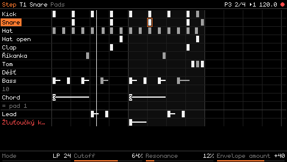
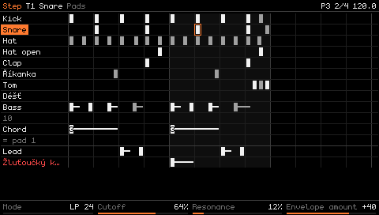
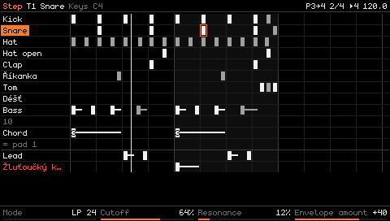
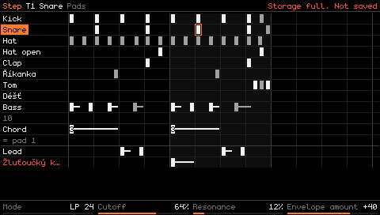

## The strip

A 1 px line, then four cells of equal width (120, 120, 119, 119 px), each holding one parameter
item for its encoder: name at the left, value at the right, 3 px inside, the 2 px bar under them;
19 px in all, at the bottom of every screen. An empty cell draws nothing. The NOTE strip (Pitch,
Velocity, Length, Position, with a range such as C3–E3 where the held notes differ) and the timing
strip (Tempo, Grid, an empty cell for Swing, Quantize) are the same cells with other items.

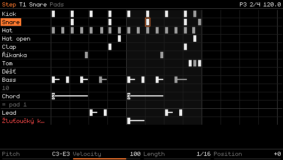
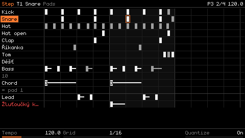

## STEP

**Scale** **(owner's choice)**: 8 px per sixteenth, so 3.5 pages of 16 are visible in 4/4. 12 and
10 px were drawn and rejected.

**Lanes.** A compact list of 13 px rows with 1 px gaps (14 px pitch), top-aligned 2 px under the
header's line; empty space below the lanes stays empty. The names column at the left: 3 px, the
widest name up to 12 characters, 3 px; the selected sound's name inverted, exactly that 3 px frame
around the word; an empty pad as its dim number; a copy lane dim ("= pad 1"); a missing sound in
red. The grid is pushed to the right edge.

**Pages of 16.** The screen draws the same pages the step buttons show: a bar shorter than 16
sixteenths leaves dark cells after its end, a longer bar continues on a second page. 3/4 is 12
cells and 4 dark; 7/8 is 14 and 2 dark; 5/4 is a full page, then 4 cells and 12 dark. Dark cells
are filled faint. The page the step buttons show is tinted. Bar lines in the line grey, beat lines
and page starts faint, faint separators between lanes, a brighter line above the extra lanes.

**Notes.** A light block 5 px wide in the 8 px cell, 1 px from the grid lines on both sides, 11 px
tall in the 13 px row; three greys by velocity; a 2 px tail for the note's length; a chord's count
as a digit on the block (5 px, no side padding at this scale); a note recorded off the grid drawn
shifted 2 px, Workflow B's marking, kept.

**The music** is a 1 px white line. **The cursor** is the orange outline around the cell, 1 px
outside it.

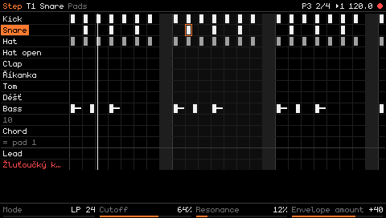
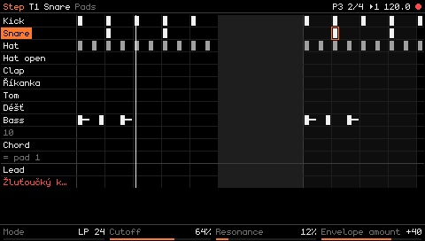

Open: whether bars should instead be drawn edge to edge at their true length, which would be a
Workflow B change; whether the chord digit stays legible on the panel; whether the off-grid shift
stays. The owner asked about the shift and accepted it so far.

## ROLL

One 13 px row per semitone, 17 rows on screen, from the same 2 px under the header; the pitch names
at the left (sharps dim); a brighter line above each C; STEP's grid, pages, tint, cursor and music
line. Every note of the track in its sound's colour, the selected sound's notes bright by velocity
and the others dim, the selected sound drawn last so it is on top; a note is a block from its exact
start as long as the note; drums sit on their root row.

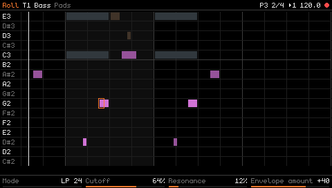

## Shared parts

- **MENU held** and **PAGE held**: the main area becomes 16 tiles in 4 columns for the 16 step
  buttons, each with its number and its name, the current screen or page outlined in the accent,
  empty tiles outlined faint.
- **A picker** replaces the main area with a list of 13 px rows, the cursor an outline as
  everywhere, the strip empty: the sound picker lists Empty, New sample, New synth, then the pool
  with each sound's engine, a missing sound in red; the sample picker shows the folder and the room
  left at the top, then folders and files with length and size, a file that does not fit dim with
  "no room".
- **A question** is a box with a 1 px outline in the middle of the main area: the question, its
  count, and what OK and Cancel do.
- **The NOTE panel** is a box over STEP with the cell's four values as parameter items, the cursor
  on one.

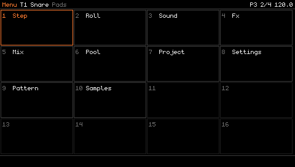
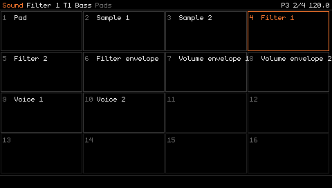
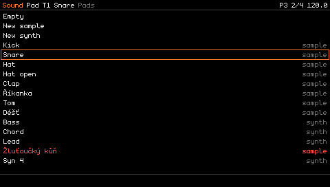
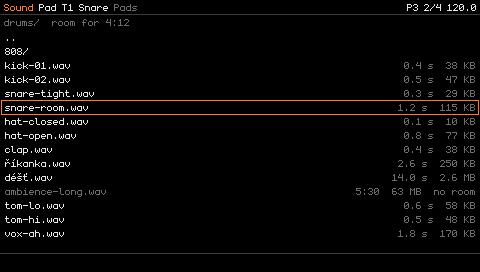
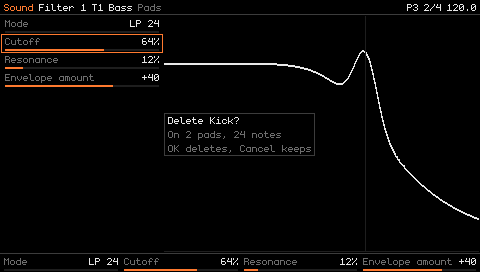
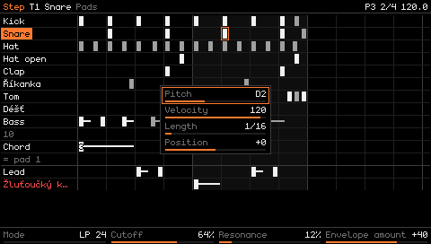

## The other screens

**A page** is its items at the left, 160 px wide with the cursor on one, and a picture at the right
where one helps; the strip repeats the items. **Pictures are cheap and informative only**
**(owner's choice)**: the Pad page shows the track's twelve pads as tiles with the selected pad in
the accent; a sample page shows the waveform with the start and end marks; an envelope page shows
the envelope's shape; a filter page shows the filter's curve with a faint line at the cutoff.
Richer graphics come later.

- **SOUND**: the pages Workflow A lists, each drawn this way.
- **FX, Chain**: the six slots as a row of tiles in chain order, the cursor on one, empty slots
  faint; under them Type and Move for that slot. The slot pages are ordinary pages.
- **MIX**: the four track levels as items, a muted track named in red; page 2 the master level.
- **SETTINGS**: Velocity, Metronome, Metronome level, Count-in as items; and a **Dev page** with
  CPU time, sample RAM and note memory as items with bars **(owner's choice)**, so the device itself
  has them and the hardware later shows real numbers in the same place.
- **POOL**: Remove unused first, then every sound with its engine, pads and cost, a missing sound in
  red; the RAM meter as an item above the strip; Delete and Remove unused in the strip.
- **PROJECT**: New first, then the projects, the open one marked "open", an old-format one marked
  "old format" in red; New, Copy, Delete in the strip.
- **PATTERN**: Timing and Bars as pages; the Patterns page lists New, then every pattern with its
  bars and note count, playing and queued marked, empty ones dim; Copy, Paste, Clear, Delete.
- **SAMPLES**: the library by folder with length and size; the storage meter as an item above the
  strip; Delete.

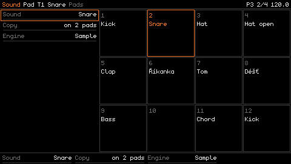
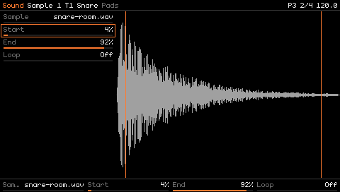
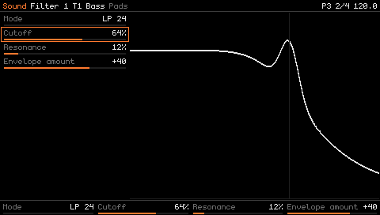
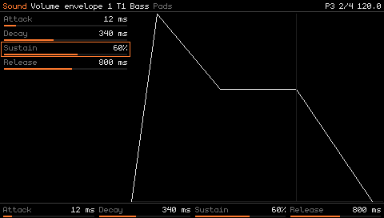
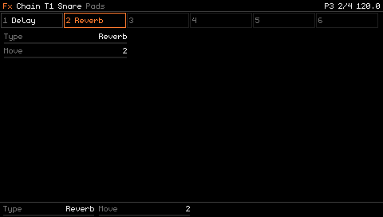
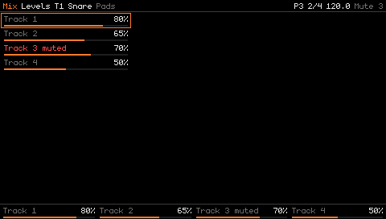
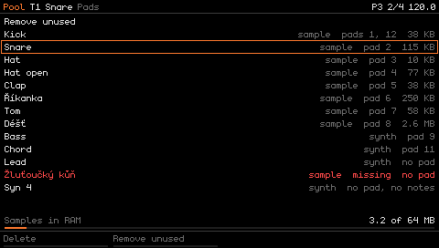
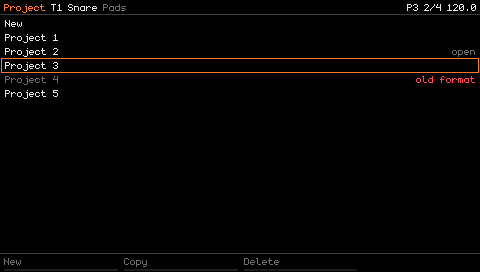
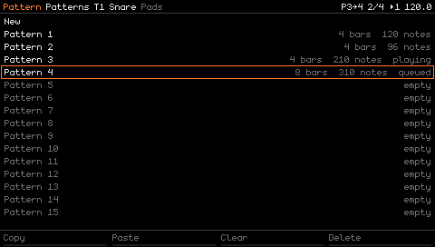
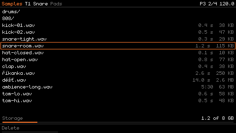

## The panel

**(owner's choice)** The owner composed the layout from a survey of 33 devices; layout D was only
the starting arrangement. 321 × 128 mm:

- **Top left**: the volume encoder; under it one row REC, PLAY, STOP, TEMPO, level with the right
  section's lower key row.
- **Top middle**: the display, centred between the two sections.
- **Top right**: the four encoders in a row (25 mm pitch), which mirrors the strip's four cells;
  under them two rows of keys: T1, T2, T3, T4, PADS/KEYS; ROLL, MENU, PAGE, COPY, SHIFT.
- **Bottom**: the 16 step buttons (15 mm pitch) over the 12 pads (20 mm pitch, 17 mm faces), with
  the navigation cluster at their right end: −, ▲, +, OK over ◀, ▼, ▶, CANCEL (15 × 20 mm keys),
  OK above CANCEL so that CANCEL + pad is a one-hand gesture for the right-hand pads.
- **No STEP button**: STEP is MENU + 1 only. ROLL keeps its button. 22 function buttons, the four
  encoders with push switches, the volume encoder, 16 steps and 12 pads.

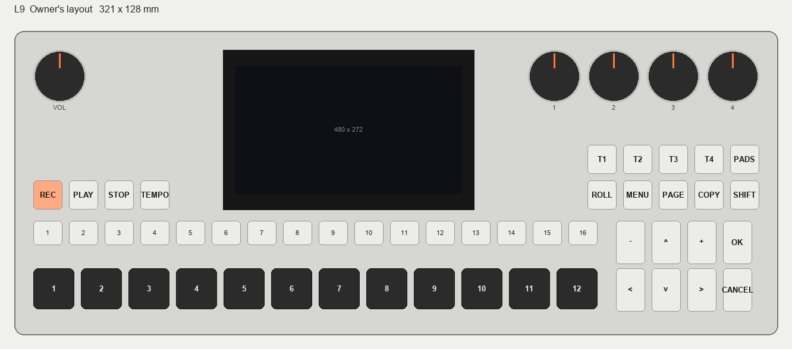

From the survey: the owner's hand model, right hand on the pads and left hand on transport and
modifiers, is the model of Maschine, Teenage Engineering, Roland, Elektron and Arturia; no device
puts a cursor cross at the end of a pad row (all nine with a cross put it beside the screen), so the
cluster's position is the one new thing; SHIFT touches transport on 11 devices; the volume is
top-left on 16 of 33; a row of four encoders beside the screen mirrors a strip of four on the OP-1
and OP-XY.

## The lights

**(owner's choice)** Single colour, on or off. Dimming is used only if the hardware gives it for
free, so nothing may depend on it. The EP-133 lights only its pads and group keys and shows
everything else on its display; this device does the same, lighting only what the screen cannot
show while the eyes are on the hands.

| Light             | On                                                                                                   |
| ----------------- | ---------------------------------------------------------------------------------------------------- |
| T1–T4             | the selected track; a muted track blinks slowly                                                      |
| REC               | blinking while armed, lit while recording                                                            |
| PLAY              | while playing                                                                                        |
| TEMPO             | while the metronome is on                                                                            |
| ROLL              | while ROLL is the screen                                                                             |
| PADS/KEYS         | in Keys mode                                                                                         |
| Step buttons      | where the selected sound has a note in the shown page; the step under the music flipped for its sixteenth; steps past a short bar's end off. SHIFT held: patterns 1–16, lit with notes, the playing one lit, the queued one blinking. MENU or PAGE held: the screens or pages that exist |
| Pads              | the selected pad; a pad flashes while its sound plays, from a hit or the sequencer. Keys mode: pad 1 (C); a key flashes while it sounds. CANCEL or COPY held: the pads that would be erased or copied blink |
| Everything else   | no light: STOP, SHIFT, MENU, PAGE, COPY, the arrows, OK, CANCEL, − and +                              |

With dimming, pads with a sound are dim and the selected one bright, and the five black-key
positions are dimmer in Keys mode.

## The browser shell

The shell shows the screen and the panel and turns input into the abstract controls Foundation
defines: presses, releases, encoder turns and pad hits with the audio clock's time stamp. The core
decides taps and holds; the shell never does. **(my call)** throughout:

- **Mouse.** Clicking a drawn key presses it, releasing lets go, so holding the mouse button holds
  the key. Clicking a pad hits it at full velocity. On an encoder, dragging up or down turns it one
  click per few pixels, and the wheel one click per notch; no acceleration. A mouse cannot hold one
  key and press another, so every two-key combination needs the keyboard for the held key.
- **Computer keyboard.** The pads on Z to /, the steps on 1 to 8 and Q to I, the arrows on the
  arrow keys, Enter for OK, Escape for CANCEL, − and + on their keys, Space for PLAY, the rest on
  letters; all in code and expected to change. Key repeat is ignored, so a held key is one press.
  Every combination works, since keys can be held together.
- **USB MIDI.** Notes play the pads with the hit's velocity: one octave maps to the twelve pads,
  and in Keys mode the note's octave shifts the pads. Channel aftertouch becomes the pressure of
  every held pad, polyphonic aftertouch of its own pad. Four controller numbers turn the four
  encoders, relative or absolute, converted to whole clicks; one more sets the volume. Nothing else
  is mapped in part 1.
- **Files.** Dropping WAV files or a folder onto the page copies them into the device's storage,
  imitated by the browser, and the core imports them as the Project model says; the header shows
  "Importing 3 files" and then the result.
- **What the shell never does:** draw anything of its own on the screen, decide a tap or a hold,
  latch a modifier, or scale the screen by a fraction.

## The screen gallery and the drift frames

The gallery (Foundation) shows every screen in fixed states. Its first states are the 27 screens in
`2026-11-07-groovebox-look/`: STEP playing, stopped, queued in Keys mode, with a message, in 7/8
and in 5/4; ROLL; SOUND's Pad, Sample 1, Filter 1 and Volume envelope 1 pages; FX Chain; MIX; POOL;
PROJECT; PATTERN's Patterns page; SAMPLES; MENU held; PAGE held; the sound and sample pickers; a
question; the NOTE panel; the NOTE strip; the timing strip; the palette; the font test. The first
implementation of each screen is compared against its picture by eye, and the drift tests' expected
frames are first recorded from the implementation that matches.

## Testing

On top of the other specs' testing:

- **Ordinary tests**: the layout rules as pure functions (text rows 13 px, items 17 px, the cursor
  1 px outside, 2 px container padding, 1 px elsewhere); shortening with "…"; the header's content
  per state; the strip's cells; STEP's page arithmetic in 4/4, 3/4, 7/8 and 5/4; ROLL's rows; the
  palette's entries; the keyboard and MIDI maps; tap-and-hold forwarding.
- **Drift scenes**: every gallery state captured as a frame.
- **The gallery** itself, with the PNGs beside it.

## Changes to the part 1 overview

Applied to the overview together with this spec:

- The Look part of the decision register points to this spec; its open questions are answered here.
- Layout D is replaced by the owner's layout; the STEP button is gone (MENU + 1).
- The milestone "the panel drawn from data" reads "the panel drawn from code".
- The glossary gains the cursor outline, the selected block and the Dev page.

## Changes to the other specs

Applied in the consistency pass:

- **Foundation**: the frame buffer is 8-bit indexed with a 256-entry palette, 128 KB (255 KB for
  two), in the budget profile; the drawing interface is fills, lines, outlined rectangles and
  glyphs; the colour palette is code, as decided.
- **Workflow A**: STEP has no button and is MENU + 1; the header names the page after the screen;
  pickers show their highlight as the cursor outline; "Sound 4" style page numbers become page
  names; SETTINGS gains the Dev page.
- **Workflow B**: "pressing STEP while on STEP follows again" becomes "jumping to the screen you
  are already on follows again" (MENU + 1 on STEP, ROLL on ROLL) **(my call)**; the screen draws
  the pages of 16 exactly as the step buttons show them, confirmed; the header's layout as above.
- **The Project model**: nothing.

## Assumptions about parts 3 and 4

- **Part 3**: a 4.3″ 480 × 272 IPS panel with a 24-bit RGB parallel interface and an LCD controller
  peripheral to stream it; four endless encoders with push switches and a fifth for the volume;
  single-colour LEDs under the pads, the step buttons, T1–T4, REC, PLAY, TEMPO, ROLL and PADS/KEYS,
  on and off at least; 12 velocity and pressure sensitive pads at 20 mm pitch; 16 step keys at 15
  mm; keys at 15 mm pitch; a panel of about 321 × 128 mm.
- **Part 4**: the layout above as the front face; the EP-133 and OP-XY as the design references for
  keycaps, legends and finish.

## Research sources

- **Displays**: Newhaven NHD-4.3-480272EF-ASXP, Riverdi RVT43HLTFWN00, Crystalfontz
  CFAF480272H0-043SN, 4D Systems 4DLCD-43480272-IPS, Winstar WF43WTWAEDNN0, Displaytech DT043BTFT
  and Adafruit 1591 datasheets and product pages; the 800 × 480, 5″ and 3.5″ classes from the same
  vendors (`research-displays.md` in the brainstorm's scratchpad).
- **Font**: [monogram](https://datagoblin.itch.io/monogram) (CC0); the `.fnt` files in this repo.
- **EP-133 K.O. II**: the official guide pages hardware overview, screen, buttons and combos, modes,
  functions, play and record, system, what's new, and the product page.
- **Pixel screens**: the Dirtywave M8 manual and the m8c client; the OP-XY guide; the Polyend
  Tracker+ and Play+ manuals; the FL Studio piano roll manual; the FastTracker II clone and Schism
  Tracker sources; the EGA and VGA palettes.
- **Panels**: 33 devices' official manuals, guides and panel drawings: Teenage Engineering EP-133,
  OP-XY, OP-Z, OP-1 field; Elektron Digitakt II, Digitone II, Syntakt, Analog Rytm MKII,
  Model:Samples; Akai MPC One+, Live II, Key 37; Native Instruments Maschine+, Mikro MK3; Synthstrom
  Deluge; Polyend Tracker+, Play+; Novation Circuit Tracks, Rhythm; Roland MC-707, MC-101,
  SP-404MK2, TR-8S; Korg electribe 2, drumlogue; Dirtywave M8; Ableton Move, Push 3; Squarp Hapax;
  Yamaha SEQTRAK; Arturia BeatStep Pro; 1010music blackbox; Sonicware Liven.
